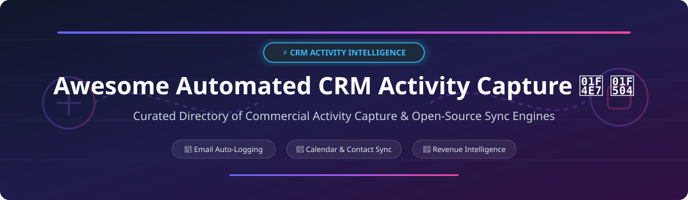

# Awesome-Automated-CRM-Activity-Capture 📧 🔄

  

  
  
  
  
  
  

---

## 🌟 Top Automated CRM Activity Capture Ecosystem ⚡

**Curated Directory of Commercial Activity Capture Platforms, Revenue Intelligence Engines & Open-Source Email/Calendar Sync Repositories**  
*Focused on Email and Calendar Auto-Logging, Contact Discovery, Revenue Intelligence, Deal Activity Timelines, Data Hygiene & Self-Hosted CRM Sync* 🚀

**Last updated: October 2026** 📅

---

### 📌 Overview & Market Intelligence Summary 📊

Welcome to the ultimate curated directory of **automated CRM activity capture platforms**, **open-source email and calendar sync tools**, and **sales activity intelligence frameworks**. Whether you are looking for enterprise-grade commercial solutions (such as *Salesforce Einstein Activity Capture*, *Clari Autocapture*, and *Gong*), or self-hostable open-source alternatives (like *Twenty*, *n8n*, *EspoCRM*, *SuiteCRM*, *Filestash*, *Kurrier*, *pagen*, and *Radiant AI CRM*), this list covers category leaders, contact discovery, and privacy-respecting activity logging.

**Key Market Context & Updates:** 💡
- **Salesforce Einstein Activity Capture (EAC)** stores emails as **EmailMessage and Task records** via the **Sync Email as Salesforce Activity** architecture, unlocking **standard reports, automation, triggers, and API access** — but **four legacy features (Activity 360 Reports, Activities Dashboard, Activity Metrics, Recommended Connections) are retiring in Spring '27 (February 2027)**.
- **Clari Autocapture** automatically captures **every contact and activity** from calendar invites and email threads, enriching with **Clearbit** and syncing to Salesforce — solving the industry challenge where **~70% of meeting attendees never get logged**.
- **Twenty CRM** is the **#1 open-source CRM (58k+ GitHub Stars)** offering modern automated activity logging, custom objects, and full data sovereignty.
- **n8n** provides **20k+ Star workflow automation** for building custom bidirectional email, calendar, and CRM activity pipelines.
- **EspoCRM & SuiteCRM** offer enterprise open-source CRM activity history tracking with full calendar & email integration.
- **pagen** is a **Go-based personal CRM sync tool** that syncs **Google Contacts, Calendar, and Gmail** incrementally in background daemon mode.

---

## 📑 Table of Contents 🗂️
- [🏢 SaaS & Commercial Platforms](#-saas--commercial-platforms)
- [🔓 Open-Source GitHub Projects](#-open-source-github-projects)
- [🛠️ How to Contribute](#%EF%B8%8F-how-to-contribute)
- [📊 Star History](#-star-history)
- [🤝 Support & Sponsorship](#-support--sponsorship)
- [⚠️ Disclaimer](#%EF%B8%8F-disclaimer)

---

## 🏢 SaaS / Commercial Platforms 📈

> 💡 **Market Size & Structure:** The Global CRM & Automated Revenue Activity Capture Software market is estimated at **$5.2 Billion (2026)** and growing at 16.8% CAGR. The sector is **moderately concentrated** with enterprise giants (Salesforce, Gong, Clari) leading revenue intelligence, alongside a vibrant ecosystem of specialized activity capture & email sync vendors.

| SaaS / Commercial Platform | Company / Owner | Valuation / Market Cap / Revenue | Starting Tier Price | Free Tier / Free Trial Limits | Description |
| :--- | :--- | :--- | :--- | :--- | :--- |
| **[Salesforce Einstein Activity Capture](https://www.salesforce.com/)** ☁️ | Salesforce | **$250 Billion Market Cap** | **$25/user/month** (Sales Cloud Starter) | **Included free with active Sales Cloud licenses** (100 EAC licenses free in Performance/Enterprise) | **CRM-native activity capture** — **Automatically syncs Gmail and Office 365 emails and calendar events to Salesforce**. **Sync Email as Salesforce Activity stores emails as EmailMessage and Task records for standard reports, automation, and API access**. **⚠️ Activity 360 Reports & Metrics retiring Spring '27 (Feb 2027)**. |
| **[Gong Activity Capture](https://www.gong.io/)** 🎙️ | Gong | **$7.2 Billion Valuation** | **$1,200/user/year** ($100/mo base + platform fee) | **14-day full platform free trial** (up to 10 recorded users & CRM integration test) | **Revenue intelligence platform** — **Records calls, captures emails, and auto-populates CRM**. **Conversation intelligence with deal risk surfacing**. Used by 5,000+ sales teams. |
| **[Clari Autocapture](https://www.clari.com/)** 🎯 | Clari | **$2.6 Billion Valuation** | **$95/user/month** (Enterprise Annual Billing) | **14-day trial / guided sandbox demo** (includes Clearbit enrichment credits) | **Revenue intelligence activity capture** — **Automatically captures every contact and activity throughout the sales cycle**. **Contacts from calendar invites and email threads are enriched with Clearbit and synced to CRM**. Solves the ~70% unlogged meeting attendee problem. |
| **[People.ai](https://people.ai/)** 📊 | People.ai | **$1.1 Billion Valuation** | **$50/user/month** (Enterprise Tier) | **14-day enterprise pilot trial** (syncs up to 50 mailboxes for evaluation) | **Revenue operations platform** — **Automatic activity capture from email, calendar, and calls**. **AI-powered contact and account insights**. |
| **[Syncari](https://syncari.com/)** 🔄 | Syncari | **$100 Million+ Valuation** | **$2,995/month** (Starter Instance Base) | **14-day full feature trial** (1 sync pipeline, up to 10k records synced) | **Data unification platform** — **Syncs activity data across CRM, marketing, and support systems** with stateful no-code sync pipelines. |
| **[Revenue.io](https://www.revenue.io/)** 🔴 | Revenue.io | **$75 Million+ Valuation** | **$75/user/month** (Growth Plan) | **14-day interactive guided trial** (includes sales call & activity logging sandbox) | **Revenue operations platform** — **Conversation intelligence and automated activity capture**. Rated Assurance Leader in ISG 2026. |
| **[Cirrus Insight](https://www.cirrusinsight.com/)** 🔵 | Cirrus Insight | **$50 Million+ Valuation** | **$10/user/month** (Salesforce Sync Tier) | **7-day free trial** (unlimited email & calendar sync for 1 user) | **Gmail and Outlook CRM sync** — **Bidirectional email and calendar sync with Salesforce**. Includes email tracking and template analytics. |
| **[Ebsta](https://www.ebsta.com/)** 📈 | Ebsta | **$30 Million+ Valuation** | **$30/user/month** (Professional Activity Sync) | **14-day free trial** (full activity capture & pipeline analytics test) | **Revenue intelligence for Salesforce** — **Activity capture, relationship intelligence, deal velocity, and forecasting**. |
| **[Match My Email](https://matchmyemail.com/)** 📧 | Match My Email | **$15 Million+ Valuation** | **$17.95/user/month** (Standard Cloud Sync) | **14-day free trial** (unlimited email parsing & automated Salesforce matching) | **Email-to-CRM capture** — **Automatically logs emails to Salesforce**. Cloud-based zero-desktop-footprint engine. |
| **[Riva Engine](https://www.rivaengine.com/)** 🟢 | Riva | **$15 Million+ Valuation** | **$9.50/user/month** (Standard Sync Engine) | **15-day enterprise test drive** (server-to-server email/calendar sync test) | **CRM sync platform** — **Bidirectional pass-through sync between email/calendar and Salesforce/Exchange/Gmail**. No client software required. |

---

## 🔓 Open-Source GitHub Projects 🛠️

*Sorted by GitHub Stars (Descending)* 🌟

- **[n8n](https://github.com/n8n-io/n8n)**   
  **Fair-code workflow automation platform with native CRM activity capture nodes**, open-source. **200,000+ GitHub Stars**. Enables custom pipelines connecting **Gmail, Outlook, Salesforce, HubSpot, and custom databases** for automated email logging, calendar event tracking, and contact enrichment. **Node.js + TypeScript + Vue** . ⚡

- **[Twenty](https://github.com/twentyhq/twenty)**   
  **The leading open-source CRM alternative to Salesforce**, open-source. **58,000+ GitHub Stars**. Built-in automated activity timeline, email sync via Messaging API, contact auto-creation, and customizable workspaces. **TypeScript + React + NestJS + PostgreSQL** . 🚀

- **[Filestash](https://github.com/mickael-kerjean/filestash)**   
  **Web client for emails, cloud storage, and CRM documents**, open-source. **14,000+ GitHub Stars**. Connects to **IMAP, CalDAV, WebDAV, and S3** for viewing and logging email activity into web workflows. **Go + Vue.js** . 📂

- **[SuiteCRM](https://github.com/suitecrm/SuiteCRM)**   
  **Enterprise open-source CRM with native email auto-archiving and calendar sync**, open-source. **5,700+ GitHub Stars**. Inbound email monitoring, automatically attaches emails to Contacts/Leads/Accounts, and manages full sales activity histories. **PHP + Angular** . 💼

- **[EspoCRM](https://github.com/espocrm/espocrm)**   
  **Feature-rich open-source CRM with email account integration & activity tracking**, open-source. **3,400+ GitHub Stars**. Automatically imports emails from multiple IMAP accounts, links them to target records, and tracks user activity logs. **PHP + Backbone.js + MySQL** . 📊

- **[Kurrier](https://github.com/kurrier-org/kurrier)**   
  **Modern self-hosted workspace for email, calendars, contacts, and storage**, open-source. **1,000+ GitHub Stars**. Connects any email provider (IMAP, SMTP, SES, SendGrid, Mailgun) with CalDAV, CardDAV, OIDC/SSO, and WebDAV storage. **Next.js + TypeScript + Nitro + PostgreSQL** . 📧

- **[OpenCRM](https://github.com/clawnify/OpenCRM)**   
  **Lightweight CRM for SaaS to manage contacts, companies, and deals**, open-source. Open-source HubSpot alternative with custom relation attributes, structured query rules, and activity tracking APIs. **TypeScript + React + Node.js** . 🏢

- **[pagen](https://github.com/harperreed/pagen)**   
  **Go-based personal CRM sync tool**, open-source. **Syncs Google Contacts, Calendar, and Gmail** incrementally with `historyId` tracking, automatic sender contact discovery, background daemon mode, and privacy-first header-only logging. **Go** . 📇

- **[Radiant AI CRM](https://github.com/dylanmeyford/radiant-ai-crm-oss)**   
  **Autonomous AI CRM that logs activity in the background**, open-source. Connects to email and calendar via Nylas, joins and transcribes meetings, analyzes activity streams, and drafts next-best actions. **TypeScript + Express + MongoDB + Nylas + OpenAI** . 🤖

- **[Personal CRM with Automatic Contact Discovery](https://github.com/ammohitchaprana/OpenClaw-Applications-Usecases)**   
  **AI-powered personal CRM workflow**, open-source. Daily cron job scans email and calendar for new contacts, stores interactions in SQLite, and provides natural language query & daily meeting prep briefings. **Python + SQLite** . 💬

---

## 🛠️ How to Contribute 🤝

Contributions are welcome! Follow these steps to submit new CRM activity capture platforms or open-source email/calendar sync software:

1. 🍴 **Fork** the repository.
2. 📝 **Add/edit** entries in `README.md` maintaining table/list structure and formatting.
3. 🔗 Include project title, official website/GitHub link, exact Stars_Count, license, and brief description.
4. 🚀 Submit a **Pull Request** with a descriptive summary of your changes.

---

## 📊 Star History

---

## 🤝 Support & Sponsorship 💖

Thank you for exploring and using this automated CRM activity capture ecosystem guide! Your support helps keep this directory up-to-date with the latest commercial platforms and open-source innovations.

- ⭐ **Star** this repository to show your appreciation and help others find it!
- 🔀 **Fork** and share with sales ops leaders, developers, and CRM architects.
- ☕ **Buy Me a Coffee / Sponsor**: Support continuous curation and open-source maintenance via the [GitHub Sponsor Dashboard](https://github.com/sponsors/ishandutta2007).

---

## ⚠️ Disclaimer ℹ️

- This is a **community-curated** list — not exhaustive and not an official vendor endorsement.
- **Salesforce EAC is migrating to Sync Email as Salesforce Activity architecture** — **Activity 360 Reports & Metrics retire in Spring '27 (February 2027)**.
- **Open-source engines require developer setup** — validate OAuth scopes, data privacy rules, and sync performance in staging before deployment.

---

  <b>Made with ❤️ for sales operations leaders, CRM administrators, and open-source activity capture advocates.</b>

